# Hasil Test

| Input/Kondisi | Hasil yang Diharapkan | Hasil Aktual |
| --- | --- | --- |
| Buka `index.html` saat API produk masih memuat data (jaringan lambat) | Halaman menampilkan status pemuatan: breadcrumb "Memuat produk...", judul "Memuat produk...", "Memuat stok", dan "Informasi produk sedang diambil dari katalog." selama data sedang diambil | 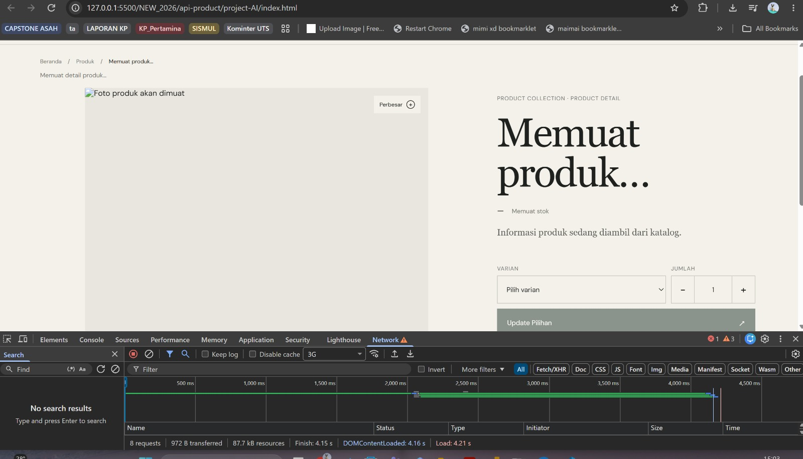 |
| Buka `index.html` saat API produk di localhost:3000 tidak dapat dihubungi | Halaman menampilkan status gagal memuat: judul "Produk tidak dapat dimuat" dan pesan error "Tidak dapat menghubungi API produk. Coba lagi setelah server siap." | 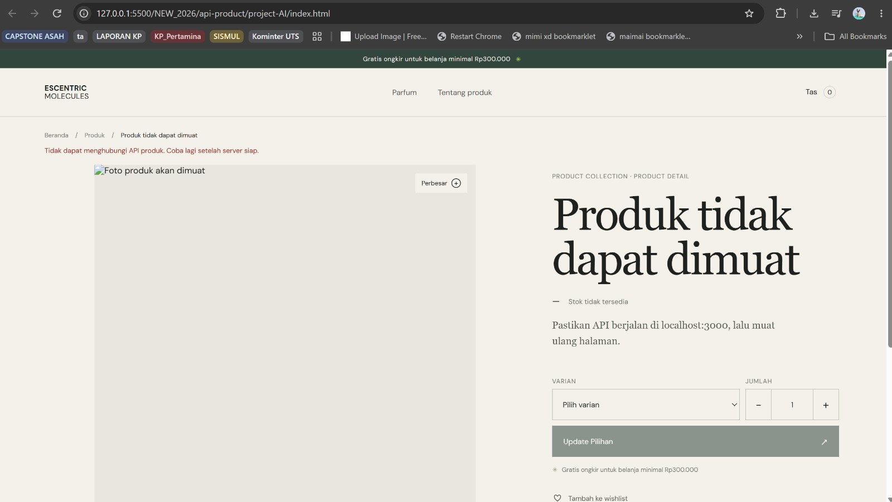 |
| `product-1.html` — pilih ukuran M, jumlah 3, harga Rp150.000 | Subtotal = 3 x Rp150.000 = Rp450.000, info ongkir "Gratis ongkir!", ringkasan dan daftar unit sesuai dengan pilihan |  |
| `product-1.html` — pilih ukuran S, jumlah 2, harga Rp150.000 | Subtotal = 2 x Rp150.000 = Rp300.000, info ongkir "Gratis ongkir!" (tepat mencapai minimum Rp300.000), ringkasan dan daftar unit sesuai dengan pilihan | 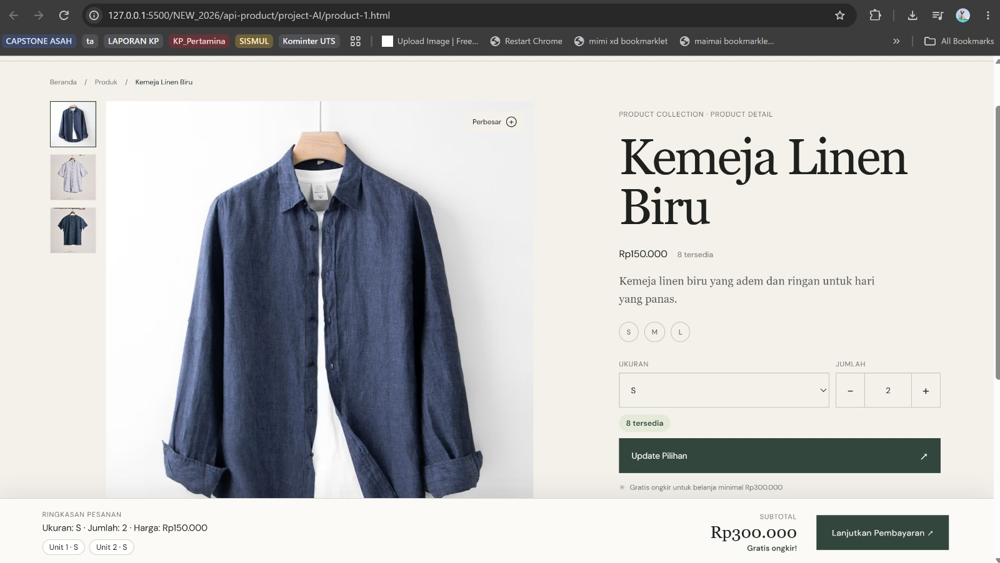 |
| Masukkan jumlah 0 (ukuran S terpilih) | Error validasi "Jumlah harus bilangan bulat positif."; ringkasan/subtotal/bar checkout disembunyikan | 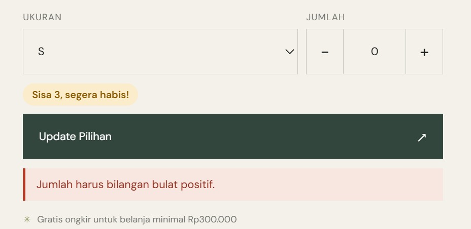 |
| Tekan tombol minus (−) saat jumlah sudah 1 (ukuran S terpilih) | Jumlah tetap 1 (tidak bisa turun di bawah 1) dan pesan "Jumlah minimal 1." ditampilkan | 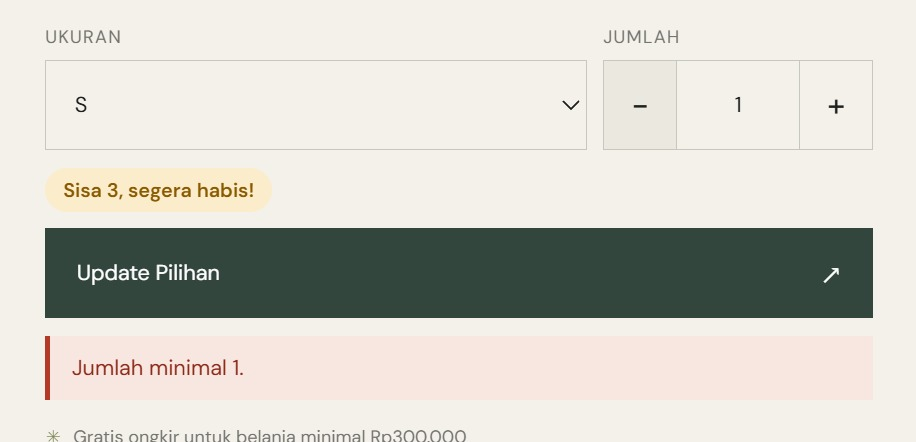 |
| Masukkan jumlah 4 saat stok hanya 3 (ukuran S terpilih) | Error validasi "Jumlah melebihi stok (sisa 3)." dan bar checkout disembunyikan | 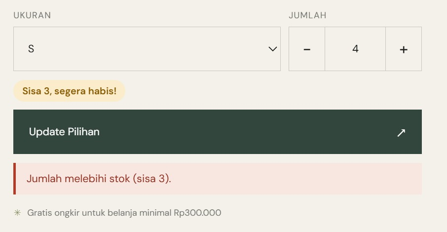 |
| `product-1.html` — pilih ukuran S (stok 5), jumlah 3, klik "Update Pilihan" | Pesan sukses "3 Kemeja Linen Biru ditambahkan ke tas.", stok S berkurang 5 -> 2 (badge "Sisa 2, segera habis!"), total stok 8 -> 5, counter tas = 3, subtotal Rp450.000 | 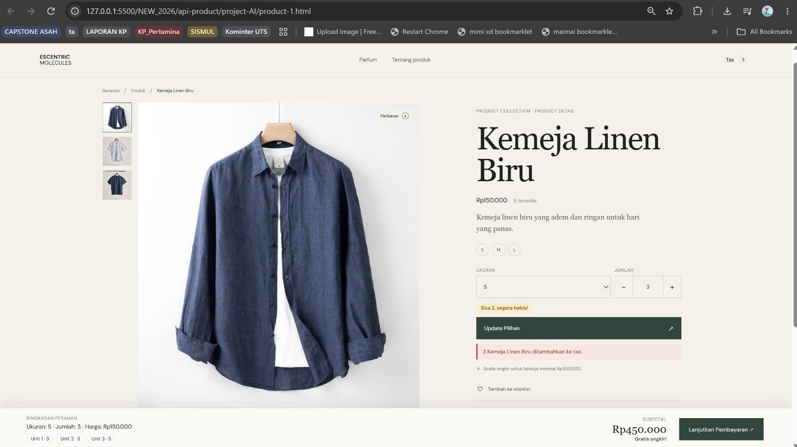 |
| Masukkan jumlah negatif, misalnya −1 (ukuran S terpilih) | Error validasi "Jumlah harus bilangan bulat positif."; ringkasan/subtotal/bar checkout disembunyikan | 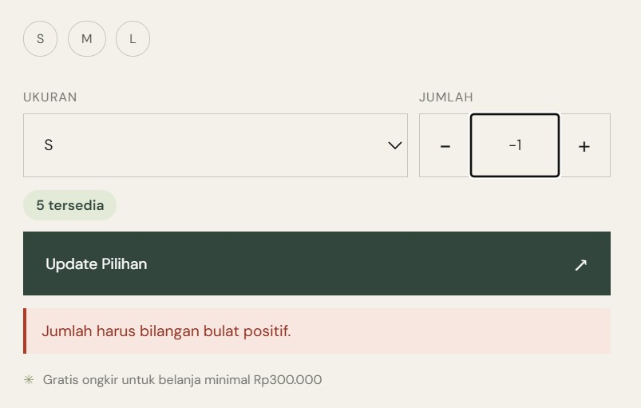 |
| Masukkan jumlah pecahan, misalnya 1,5 (ukuran S terpilih) | Error validasi "Jumlah harus bilangan bulat positif."; ringkasan/subtotal/bar checkout disembunyikan | 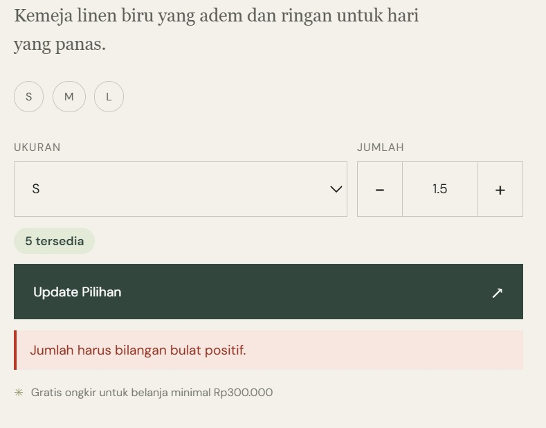 |
| Buka `index.html` saat API produk berjalan di localhost:3000 | Produk berhasil dirender dari response endpoint baseline: judul "Kaos Katun Polos", harga Rp150.000, stok "30 tersedia", deskripsi, dan variasi (S · M · L) tampil sesuai data API; panel Network menunjukkan hanya satu request `GET /api/products/1` dan indikator loading tidak tertinggal | 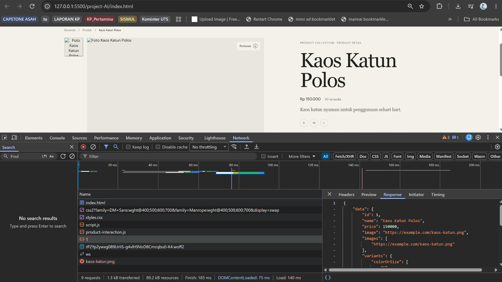 |
| Buka `index.html` dengan ID yang tidak ada di API, misalnya `?id=999` | Halaman menampilkan status gagal memuat: status "Produk tidak ditemukan.", judul "Produk tidak dapat dimuat", dan pesan "Pastikan API berjalan di localhost:3000, lalu muat ulang halaman."; indikator loading tidak tertinggal | 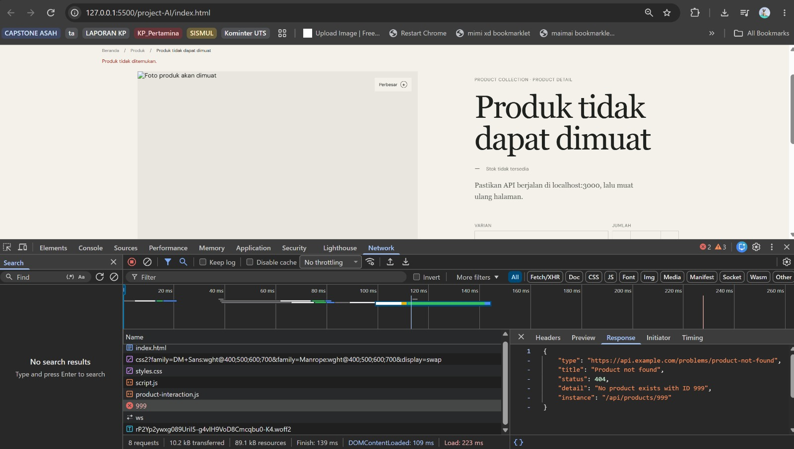 |
